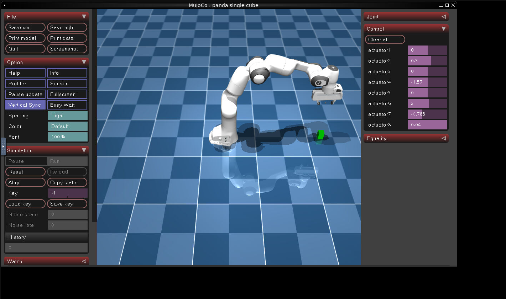

# Отчет по проделанной работе

## Демонстрация работы `panda_teleop.py`

## Эксперименты

Стандартная позиция куба: $(0; 0.5)$,

Безопасный диапазон: $(\pm 0.3; \pm 0.3)$

Поиск $SR \sim /text{in-domain} / 2$

| Эксперимент   | Параметры                     | Success Rate (n/10) |
| ------------- | ----------------------------- | ------------------- |
| 1 (in-domain) | -                             | 9                   |
| 2.1           | cube_x=0.15, cube_y=0.1       | 0                   |
| 2.2           | cube_x=0.25, cube_y=0.15      | 0                   |
| 2.3           | cube_x=0.35, cube_y=0.2       | 0                   |
| 2.4           | cube_x=0.5, cube_y=0.4        | 3                   |
| 2.5           | cube_x=0.53, cube_y=0.4       | 3                   |
| 2.6           | cube_x=0.55, cube_y=0.4       | 6                   |
| 2.7           | cube_x=0.5, cube_y=0.45       | 0                   |
| 2.8           | cube_x=0.54, cube_y=0.4       | 6                   |
| **2.9**       | **cube_x=0.53, cube_y=0.41**  | **4**               |
| **2.10**      | **cube_x=0.53, cube_y=0.405** | **5**               |
| **3.1**       | **obs_noise=0.02**            | **5**               |
| 3.2           | obs_noise=0.05                | 1                   |
| 3.3           | obs_noise=0.1                 | 0                   |
| 3.4           | obs_noise=0.2                 | 0                   |
| **3.5**       | **obs_noise=0.03**            | **4**               |
